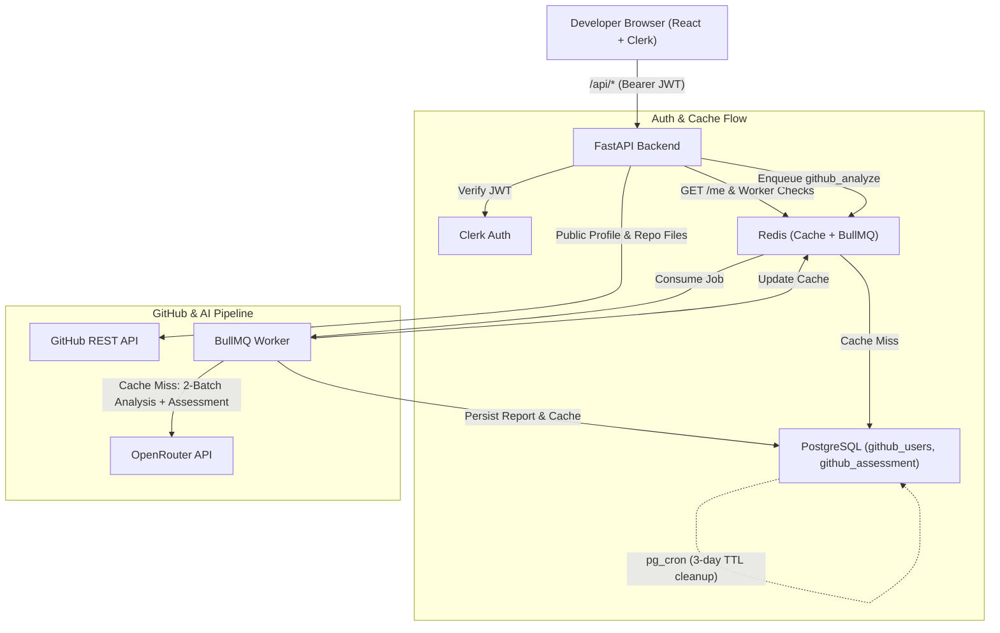
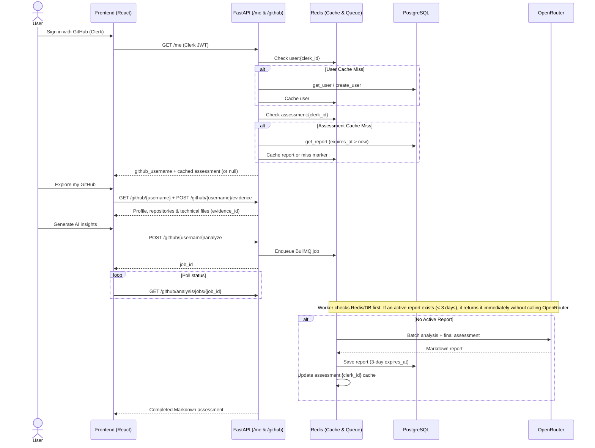

# GitLens

GitLens reviews your GitHub portfolio and suggests practical improvements for the engineering roles you are targeting. It analyzes READMEs and technical manifests from up to 50 of your most recently updated public repositories (including forks), combined with any career context you choose to share.

---

## Architecture Overview



---

## Authentication & Assessment Flow



---

## Requirements

- **Python** 3.14+ and [uv](https://docs.astral.sh/uv/)
- **Node.js** 22.12+ (or a supported newer LTS) and `npm`
- **Clerk** application with GitHub sign-in enabled
- **Redis** for BullMQ job queueing and user/assessment caching
- **PostgreSQL** for `github_users` and `github_assessment` (with `pg_cron` for 3-day expiration cleanup)
- **GitHub Token** (for public GitHub API requests) and an **OpenRouter API Key**

---

## Backend Setup

Create `backend/.env` with your local or hosted credentials (never commit `.env` files to version control):

| Variable | Description |
| --- | --- |
| `GITHUB_TOKEN` | Personal access token used to fetch public GitHub data |
| `CLERK_SECRET_KEY` | Secret key from your Clerk application |
| `CLERK_AUTHORIZED_PARTIES` | Allowed Clerk session origins (use `http://localhost:5173` locally) |
| `REDIS_URL` | Redis connection URL (use the TCP URL for hosted Redis) |
| `OPENROUTER_API_KEY` | API key used for batch analysis and the final assessment |
| `DATABASE_URL` | PostgreSQL connection URL starting with `postgresql+psycopg://` |

Keep any connection options your PostgreSQL provider requires (such as `sslmode=require&channel_binding=require`). Alembic reads `DATABASE_URL` from the backend environment.

```bash
cd backend
uv sync
uv run alembic upgrade head
uv run uvicorn app.main:app --reload --port 8000
```

### Key Backend Behavior

- **Protected Routes:** All `/me` and `/github/*` endpoints require Clerk JWT authentication.
- **Database Schema:** The initial Alembic migration creates `github_users` and `github_assessment` (up to one active assessment per user, retained for 3 days and cleaned up via `pg_cron`).
- **Background Worker:** FastAPI starts the BullMQ worker automatically on startup. If an active assessment already exists within the 3-day window, the worker returns it from Redis/PostgreSQL instead of re-running OpenRouter.

---

## Frontend Setup

### 1. Configure Clerk
In the Clerk Dashboard:
1. Enable **GitHub** for sign-up and sign-in, and disable other sign-in methods.
2. Under **Sessions → Customize session token**, add the following claim:

```json
{
  "github_username": "{{user.public_metadata.github_username}}"
}
```

On first sign-in, FastAPI resolves the username from the connected GitHub account and populates `public_metadata` if the claim is missing.

### 2. Configure Environment & Run

Create `frontend/.env.local` with the publishable key from the same Clerk application. Leave `VITE_API_BASE_URL` empty for local development:

```dotenv
VITE_CLERK_PUBLISHABLE_KEY=
VITE_API_BASE_URL=
```

```bash
cd frontend
npm install
npm run dev
```

Open `http://localhost:5173`. Vite proxies `/api` requests to FastAPI on port `8000`.

### 3. Using the App

1. Sign in with GitHub and choose **Explore my GitHub** to load your profile, repositories, and technical evidence (plus any cached assessment from the last 3 days).
2. Open **AI insights** to add optional target roles, goals, and project context, then generate a report.
3. Choose **View example** at any time to preview a fictional portfolio review.

For a deployed frontend, set `VITE_API_BASE_URL` before building and include the deployed origin in `FRONTEND_ORIGINS` and `CLERK_AUTHORIZED_PARTIES` on the backend.
