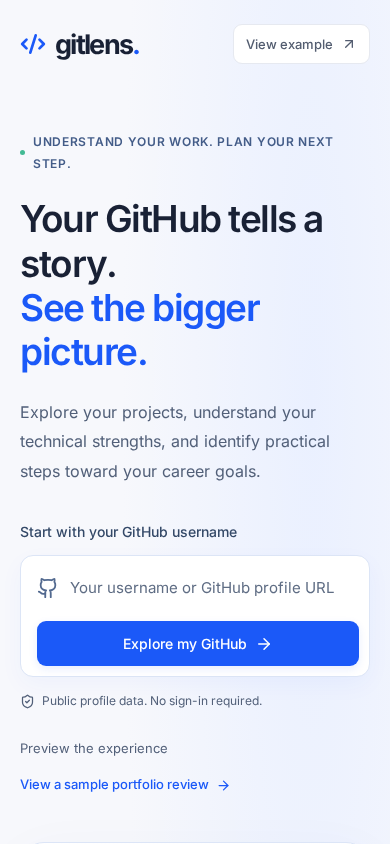
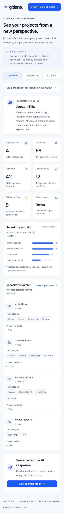
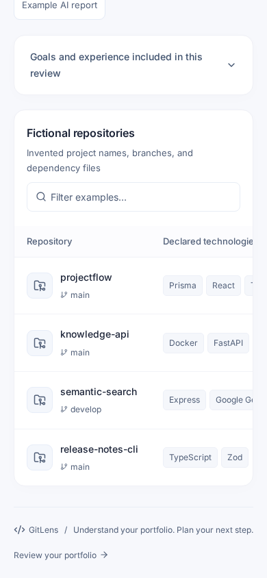
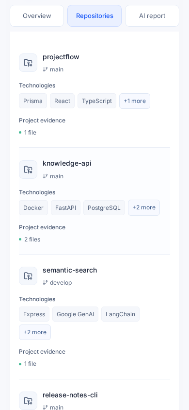
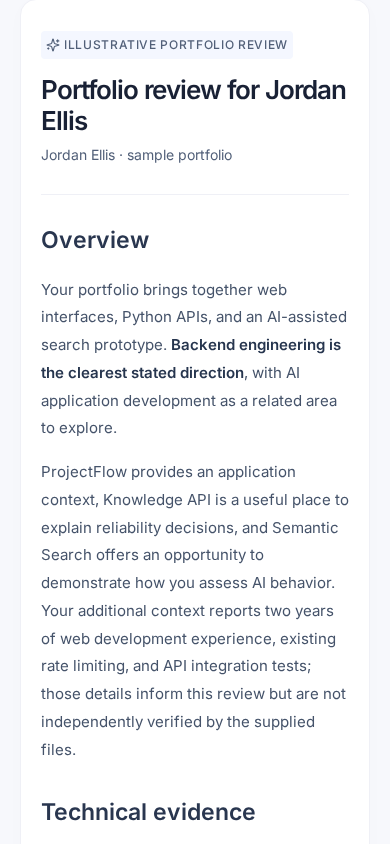
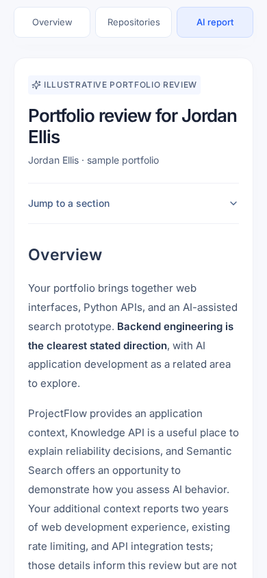
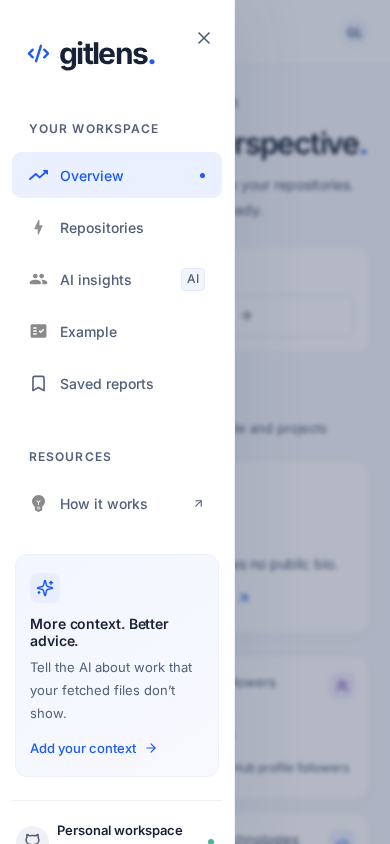
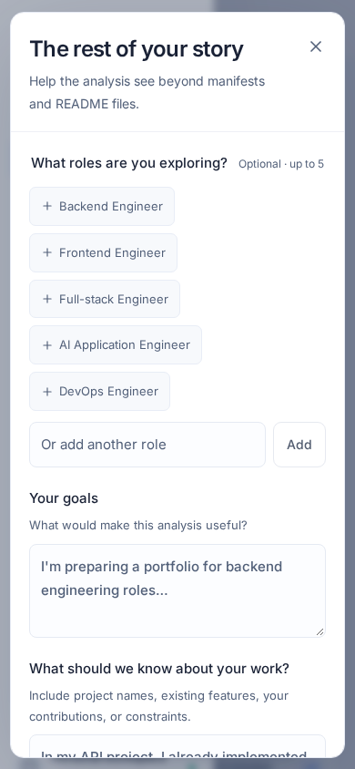
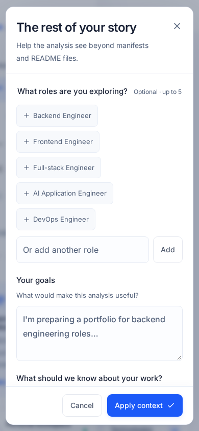

# GitLens UI review and fixes

Reviewed on 14 November 2026 using the Product Design audit guidance and the existing browser workflow. Publication uses Sites. The review preserves the current blue-and-white design and the separation between live GitHub data and fictional sample content.

## Scope and evidence

The reviewed journey is landing page → verified profile or public sample → repositories → AI report → mobile navigation → optional context. Captures use 1440 × 1000 desktop and 390 × 844 mobile viewports. Every screenshot below was captured and inspected during this review. The stable UI baseline was captured after the requested username gate was implemented; earlier captures showing a drawer mid-transition were rejected.

Strengths retained: readable text contrast, a clear primary profile action, explicit sample labeling, useful report sections, and separate requests for profile data and AI generation.

## Findings and resulting behavior

| Step | Surface | Finding | Result | Health |
| --- | --- | --- | --- | --- |
| 1 | Landing and profile entry | Desktop vertical centering pushed the form downward; the mobile introduction consumed much of the first screen. | Top-aligned the hero, tightened mobile spacing, and retained readable type. Errors are associated with the input. | Improved; tested |
| 2 | Workspace gate and public sample | The main workspace must not be available without a confirmed profile. Public demo navigation previously resembled the live workspace. | Require a successful matching profile response; reject malformed profiles and repository URLs. Keep the sample on a standalone page without main navigation. | Verified |
| 3 | Repository list | A desktop-width table clipped technologies and evidence on mobile. Extra technologies depended on a hover title. | Use mobile cards with labeled fields and keyboard-accessible expandable technology lists. Keep the desktop table and the actual repository source. | Fixed; tested |
| 4 | AI report | Long reports lacked a way to jump between sections. | Add a section navigator with stable anchors, a readable content width, and scroll offsets below sticky tabs. Preserve the model's Markdown content. | Fixed; tested |
| 5 | Mobile navigation | The drawer needed explicit keyboard containment, Escape handling, background isolation, and reliable focus return. Notifications could obscure its lower controls. | Add a close control, focus management, inert background, Escape support, body scroll locking, and clear notifications when the drawer opens. | Fixed; tested |
| 6 | Optional context | On mobile, Apply context was below a long scrolling form. Closing the dialog did not reliably restore focus. | Keep the form body scrollable and the action row visible. Restore focus to the opener and use 16px mobile input text. | Fixed; tested |

## 1. Landing and profile entry

The form is higher on the page while the explanation remains readable. Username entry accepts a handle or a GitHub profile URL, including `github.com/username`. Repository URLs, unrelated hosts, embedded credentials, invalid handles, missing accounts, mismatched responses, and malformed profile records cannot open the main workspace. A valid-looking string alone does not unlock it.

Before:

After:

[Desktop capture](ui-review/after-01-landing-desktop.png)

## 2. Public sample and verified workspace

The sample has its own header and compact tabs. Visitors may explore fictional projects and reports, but there is no main navigation until a real profile lookup succeeds. Saved browser reports and URL parameters cannot bypass the gate. Changing users clears the previous profile's repositories, report, and user-specific context.

The gate is verified through controlled successful, missing, mismatched, malformed, and failed responses. It is not inferred from the screenshot alone.

## 3. Repository details

Before: the mobile viewport hid technology and evidence columns to the right.

After: repository names, branches, technology tags, and file counts fit inside the viewport. Additional technologies open through a disclosure control that works with touch and keyboard.

## 4. Reading an AI report

Before: long report content required manual scrolling to find recommendations.

After: Jump to a section links to stable headings. Sample tabs support Arrow Left/Right, Home, and End. Section links remain usable below the sticky tab row.

## 5. Mobile navigation

The drawer has an explicit close button. Tab and Shift+Tab remain within it, Escape closes it, and focus returns to the menu trigger. The underlying page is inert while the drawer is open. Opening it clears notifications that could cover navigation controls.

## 6. Optional context

Before: the primary action was outside the initial mobile dialog viewport.

After: Cancel and Apply context remain visible while the fields scroll. Native dialog behavior and explicit focus restoration keep keyboard navigation predictable.

## Verification and limits

- Nine unit tests passed for profile input, response validation, request separation, context forwarding, Markdown headings, and evidence extraction.
- Ten interaction tests and one fresh screenshot-capture test passed. They include the profile gate, isolated sample, failed requests, account switching, report navigation, technology disclosure, mobile reflow, focus containment, and dialog actions.
- Production TypeScript compilation and the Vite build passed. A final screenshot capture also passed after the notification-overlap fix.
- Test responses were controlled locally. This review does not establish live GitHub/Gemini availability, model-output quality, or the correctness of unseen repository code.
- Screenshots and keyboard checks support the findings above. A complete screen-reader audit, assistive-technology matrix, and formal WCAG conformance assessment were not performed.

Reproduce with `npm test`, `npm run build`, and `npm run test:e2e` from `frontend/`. Screenshot captures are implemented in `e2e/ui-audit.spec.ts`.
